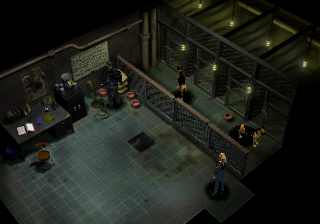

# Parasite Eve

[](https://discord.gg/bQkCVvrkem)

A native PC port of Parasite Eve, built from the original game code with
[our PsyZ fork](https://github.com/khasinski/parasite-eve-psyz).



## Play

Download the game from [GitHub Releases](https://github.com/khasinski/parasite-eve-pc/releases).
This is an early alpha; see the release notes for available platforms and known issues.
See the [changelog](CHANGELOG.md) for changes.

You need your own **North American CUE/BIN images**. Game data is not included.
Keep each CUE file next to its BIN file.

1. Launch Parasite Eve and select your disc images. Selecting both discs enables automatic switching.
2. You can start with either disc. If the other is needed, the game asks for it by name.
3. Press **Escape** for graphics, controls, audio and disc settings. You can add the other disc there later.

**Enter** is START and skips movies. View or change all bindings in **Escape → Controls**.
Settings and selected disc paths are saved automatically.

## Build

Requires Git, CMake 3.21 or newer and a C11 compiler.

```sh
git clone https://github.com/khasinski/parasite-eve-pc
cd parasite-eve-pc
git submodule update --init third_party/psyz
git -C third_party/psyz submodule update --init external/SDL
cmake -S . -B build -DBUILD_TESTING=OFF -DCMAKE_BUILD_TYPE=RelWithDebInfo
cmake --build build --parallel
./build/parasite-eve-pc
```

For development details, see [code organization](docs/CODE_ORGANIZATION.md).
